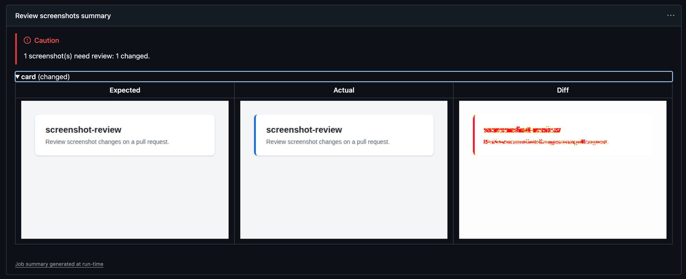
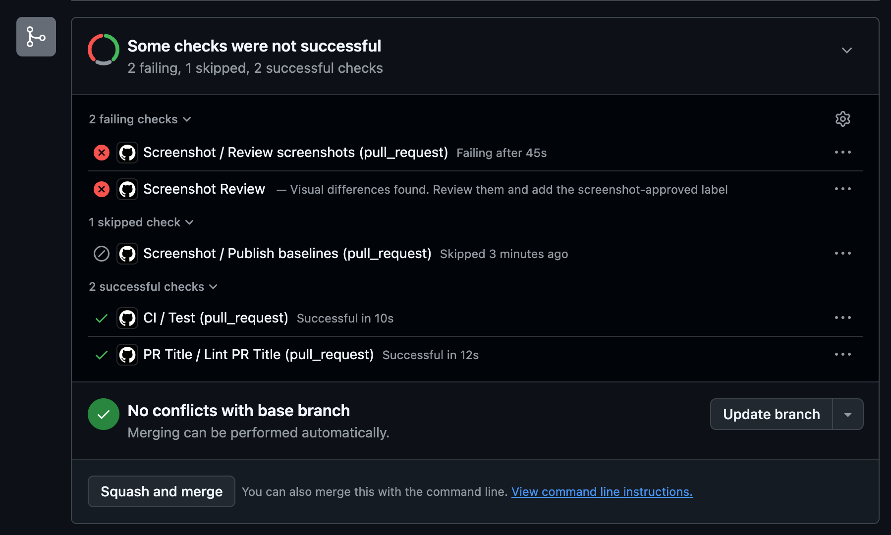
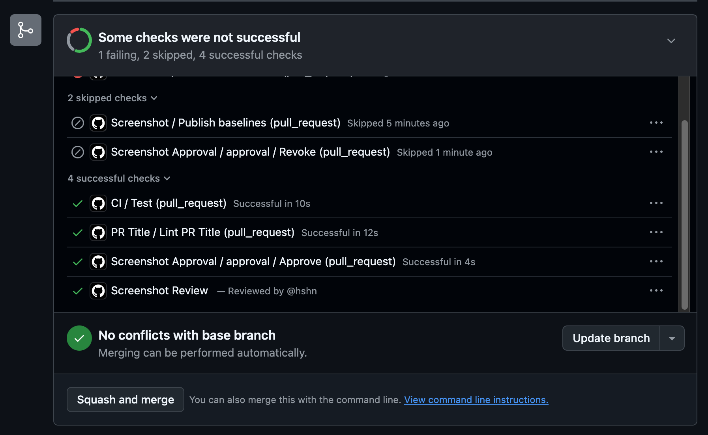

# screenshot-review

Review screenshot changes on a pull request. Baselines live on their own branch, not in
the working tree, so pull requests never serialize behind each other's baseline updates.

## How it works

- A push to the default branch captures a new generation of baselines onto a storage
  branch, named by the commit it was captured for.
- A pull request pulls the generation captured at its branch point and compares against
  it. When that generation is gone it falls back to the latest one and says so.
- A failed comparison pushes the screenshots to a side branch and writes them into the job
  summary, then writes a failing commit status.
- A human looks at them and adds a label. That flips the status to success. The status is
  per commit, so a new push silently drops the approval.

## What a reviewer sees

Taken from [#19](https://github.com/hshn/screenshot-review/pull/19), a pull request that
gave the card in this repository's own screenshot suite an accent border.

The job summary shows each screenshot needing review: the baseline, what the pull
request renders, and the pixels that differ.



The pull request gets a failing `Screenshot Review` status saying what to do next.



Adding the `screenshot-approved` label turns it into a success naming the reviewer. The
`Review screenshots` job stays failed: the label changes the status, not the job, so
require `Screenshot Review` rather than the job.



## Actions

| Action             | What it does                                                       |
| ------------------ | ------------------------------------------------------------------ |
| `run`              | Runs a command inside the official Playwright image                |
| `baseline-pull`    | Fetches one generation of baselines from the storage branch        |
| `baseline-publish` | Publishes one generation to the storage branch                     |
| `diff-report`      | Collects the screenshots needing review and writes the job summary |
| `review-status`    | Writes the commit status that gates the pull request               |

Every input has a default matching the layout described above. Nothing about your
repository — branch names, directories, labels, status names, package manager, script
names — is baked in.

## Permissions

Each action asks its caller for only what it does:

- `review-status` writes a commit status, so its job needs `statuses: write`.
- `baseline-publish` and `diff-report` push to a branch, so their jobs need
  `contents: write`.
- `baseline-pull` and `run` only read, so the job's default `contents: read` (from
  checkout) covers them.

Set these on the job, not on the step that calls into an action — a called action or
reusable workflow cannot grant itself more than its caller's job already has.

## Wiring them together

This is how the pieces above compose into one screenshot job. It pulls the baseline,
runs the comparison, and reports either a diff or a status depending on the outcome:

<!-- x-release-please-start-version -->
```yaml
jobs:
  screenshot:
    runs-on: ubuntu-latest
    permissions:
      contents: write
      statuses: write
    steps:
      - uses: actions/checkout@v7
        with:
          ref: ${{ github.event.pull_request.head.sha }}
          fetch-depth: 0

      - name: Install dependencies
        run: npm ci

      - name: Pull baseline
        id: baseline
        uses: hshn/screenshot-review/baseline-pull@v0.2.1

      - name: Run screenshot tests
        id: screenshot
        uses: hshn/screenshot-review/run@v0.2.1
        with:
          command: npx playwright test

      - name: Report diffs
        if: failure() && steps.screenshot.outcome == 'failure'
        uses: hshn/screenshot-review/diff-report@v0.2.1
        with:
          pr-number: ${{ github.event.pull_request.number }}
          github-token: ${{ github.token }}

      - name: Write status
        if: always()
        uses: hshn/screenshot-review/review-status@v0.2.1
        with:
          sha: ${{ github.event.pull_request.head.sha }}
          state: ${{ steps.screenshot.outcome == 'success' && 'success' || 'failure' }}
          note: ${{ steps.baseline.outputs.note }}
          github-token: ${{ github.token }}
```
<!-- x-release-please-end -->

`run` needs the repository's dependencies installed before it starts. It picks its image
from the `@playwright/test` version installed on the host, and the command it runs in
the container uses that same installation, since the working directory is mounted into
it. Passing `version:` or `image:` skips only the first of the two. Install with whatever
package manager the repository uses; the example uses npm.

The job grants `contents: write` so `diff-report`'s token can push the side branch it
needs. A token scoped separately (a GitHub App installation token, for instance) is the
tighter alternative to widening the whole job's permissions for one conditional step.

## Playwright config

One setting this workflow requires: `baseline-pull` writes the generation it fetched to
`snapshotPathTemplate`, so the suite has to read its baselines from the same place.

```ts
export default defineConfig({
  // Baselines are not shared through the working tree; baseline-pull writes them here.
  snapshotPathTemplate: '.screenshot-baselines/{arg}{ext}',
});
```

`updateSnapshots` can stay at Playwright's default. A screenshot with no baseline then
fails and Playwright writes its actual image into that directory, but `baseline-pull`
also leaves a `.pulled` file there listing what it fetched, and `diff-report` judges by
that list — so the screenshot is reported as added, not as changed against itself.

What counts as a change — `threshold`, `maxDiffPixels`, `maxDiffPixelRatio` — depends on
what your screenshots contain, and is Playwright's to define rather than this workflow's:
see [`toHaveScreenshot`](https://playwright.dev/docs/api/class-pageassertions#page-assertions-to-have-screenshot-1).

Capture and compare in the same rendering environment. Fonts differ enough between a
developer's machine and a Linux container to produce a difference on every screenshot,
which is why `run` goes through the Playwright image rather than the host.

## Approval workflow

`.github/workflows/approval.yml` is a reusable workflow: a human adding the approval
label writes the success status, and a later push revokes it. Call it on the two pull
request events it acts on:

<!-- x-release-please-start-version -->
```yaml
name: Screenshot Approval

on:
  pull_request:
    types: [labeled, synchronize]

jobs:
  approval:
    uses: hshn/screenshot-review/.github/workflows/approval.yml@v0.2.1
    permissions:
      contents: read
      statuses: write
      pull-requests: write
```
<!-- x-release-please-end -->

Approving writes the status, so it needs `statuses: write`; revoking removes the label,
so it needs `pull-requests: write`.

It takes two inputs, `label` (default `screenshot-approved`) and `status-context`
(default `Screenshot Review`, matched against `review-status`'s own `context` default),
so callers can rename either without editing the workflow.

The pull request page shows only the latest status per context, so the approval keeps
the link of the status it replaces: Details still opens the tests' run, where the
screenshots are, and the description says who approved. If the label lands before the
tests have written their status, there is nothing to keep and the approval links to its
own run — the tests' status then overwrites it anyway, and the label has to be added
again once they finish.

The same is available to a hand-written approval job through `review-status`'s
`keep-target-url` input.

## Upgrading

A release changes nothing for a caller until the caller moves its own `uses:` refs —
both the actions in its screenshot job and `approval.yml` in its approval workflow.
Bumping one and not the other leaves the old behavior in place without a word, so move
them together. Each release's changes are in `CHANGELOG.md` and on the GitHub release.

## Command line

`bin/cli.mjs` is the local equivalent of the actions above, exposed as the
`screenshot-review` bin. It runs the same scripts the actions call, so what passes
locally passes in CI:

```sh
screenshot-review baseline pull --base-branch develop
screenshot-review run --command "npx playwright test"
```

## Working directory

`run`'s default image comes from the installed `@playwright/test` version, resolved via
Node's module resolution starting at `process.cwd()`. If the job's working directory
is not where the repository's `package.json` lives — a monorepo whose screenshot suite
sits in a subpackage, for instance — that resolution can find the wrong installation or
none at all. Pass `version:` or `image:` explicitly in that case instead of relying on
the default.
